# PulseBox Cyber Desk 🕹️⚡

[](https://github.com/your-username/pulsebox-cyber-desk/actions/workflows/ci.yml)
[](https://your-username.github.io/pulsebox-cyber-desk/)
[](#-security--threat-model)
[](#-test-suites--ci-verification)
[](LICENSE)
[](firmware/)

> **A tactile physical-digital micro desk fixture and 320×240 embedded display that bridges real-world developer operations with an original retro-voxel aesthetic.**

[🎮 Launch Live Web Simulator Demo](https://your-username.github.io/pulsebox-cyber-desk/) &nbsp;|&nbsp; [📖 Design Specification](docs/DESIGN.md) &nbsp;|&nbsp; [🔒 Security Policy](SECURITY.md)

---

## 📽️ Hero Preview

<div align="center">
  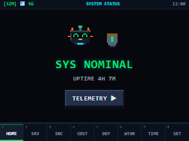
  <p><em>Smooth screen wipes across all 8 native screens on an 8px modular voxel grid with dual 16-color palettes.</em></p>
</div>

<div align="center">
  <table>
    <tr>
      <td align="center"><b>Incident Outage Alert</b></td>
      <td align="center"><b>Automated Cluster Recovery</b></td>
      <td align="center"><b>Pomodoro Level-Up Chime</b></td>
    </tr>
    <tr>
      <td></td>
      <td>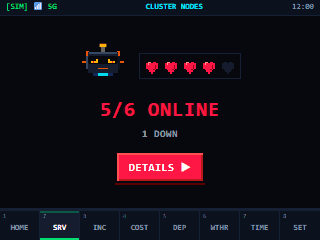</td>
      <td>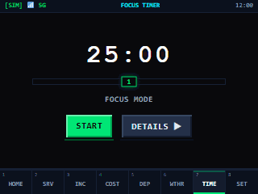</td>
    </tr>
    <tr>
      <td align="center"><em>Redstone alarm + worried mascot</em></td>
      <td align="center"><em>Lush grass + celebrating mascot</em></td>
      <td align="center"><em>XP progress bar + Web Audio chime</em></td>
    </tr>
  </table>
</div>

---

## 🌟 What is PulseBox?

PulseBox is a hybrid embedded IoT fixture and developer dashboard built for engineers who want physical ambient awareness of their systems without distracting browser tabs.

Sitting on your desk, PulseBox couples an **ESP32 microcontroller** and **2.8-inch 320×240 touchscreen display** with a hardened **Python Flask backend** and a **pixel-accurate web embedded simulator**. It reports real-time microservice health, incident alerts, cloud infrastructure burn rates, release pipeline states, weather, and focus sprints through an original voxel / sandbox visual language.

### Key Capabilities
- **Glanceable Telemetry:** Designed for comprehension in under 1 second from 3 feet away.
- **Progressive Disclosure:** Simple hero readouts on top; detailed telemetry and controls "behind-the-tap".
- **Dual Indexed Palettes:** 16-color **Day Palette** (earth, loam, grass, sunlight) and 16-color **Night Palette** (low-glare obsidian, neon mint, plasma orange).
- **100% Original IP:** Handcrafted procedural sprites and voxel geometries—strictly zero third-party game assets.
- **Hardware-Software Mirroring:** Unified tokens generate both web CSS custom properties and 16-bit RGB565 C++ macros for TFT displays.
- **Enterprise-Grade Security:** Loopback by default, Bearer token auth for mutations, CORS lockdown, rate limiting, and pinned Root CA TLS.

---

## 📸 Screen Gallery

Each screen follows the strict **Hero Element Rule** (readable in <1 second) with **maximum 3 text elements and 12 words** per screen. Tap any screen or button to enter its high-density **Detail View**.

| Screen | Hero Overview | Behind-The-Tap Detail View | Core Functionality |
| :--- | :---: | :---: | :--- |
| **1. System Status** | 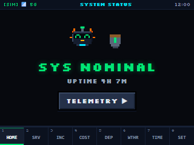 | 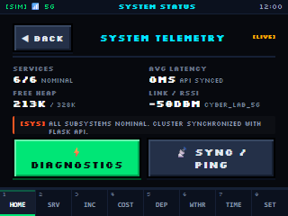 | High-level system uptime, telemetry heartbeat, and overall status shield. |
| **2. Cluster Nodes** | 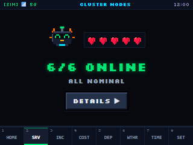 | 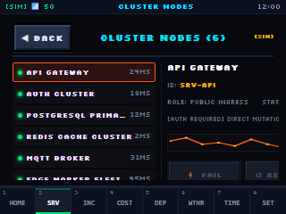 | Heart bar health readout (6 nodes), per-node latency history, and failure simulation. |
| **3. Incident Log** | 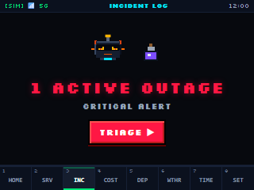 | 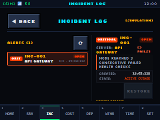 | Streak counter (3-strike alarm), outage triage, and Telegram notification log. |
| **4. Cloud Costs** | 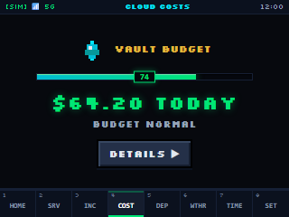 | 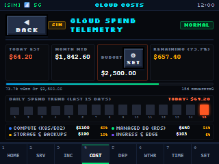 | Crystal & XP level bar, 15-day spend trend, 4-tier breakdown, and budget steppers. |
| **5. Release Pipeline**| 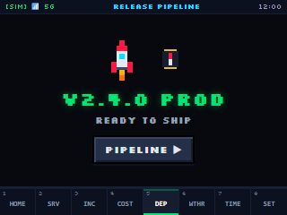 | 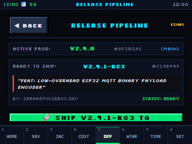 | Voxel rocket status, git commit SHA, CI artifact verification, and rollback. |
| **6. Weather & Clock** | 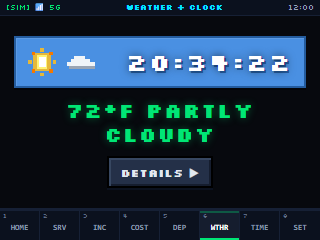 | 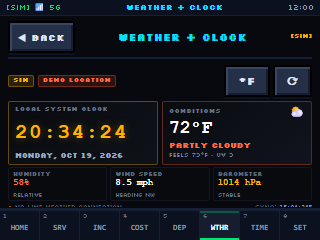 | Dynamic day/night procedural sky, large digital clock, barometric telemetry, and °C/°F toggle. |
| **7. Focus Timer** | 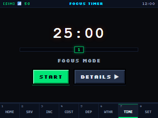 | 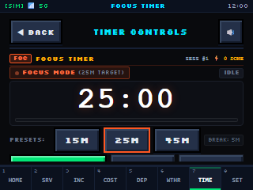 | Zero-drift Pomodoro timer, 15m/25m/45m presets, XP session count, and Web Audio SFX. |
| **8. Device Config** | 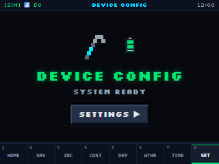 | 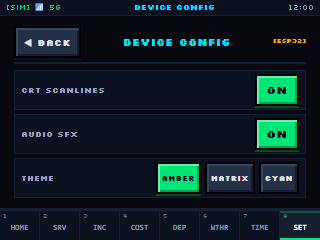 | Day/Night toggle, display brightness, Wi-Fi telemetry, and hold-to-confirm factory reset. |

---

## 🏗️ System Architecture

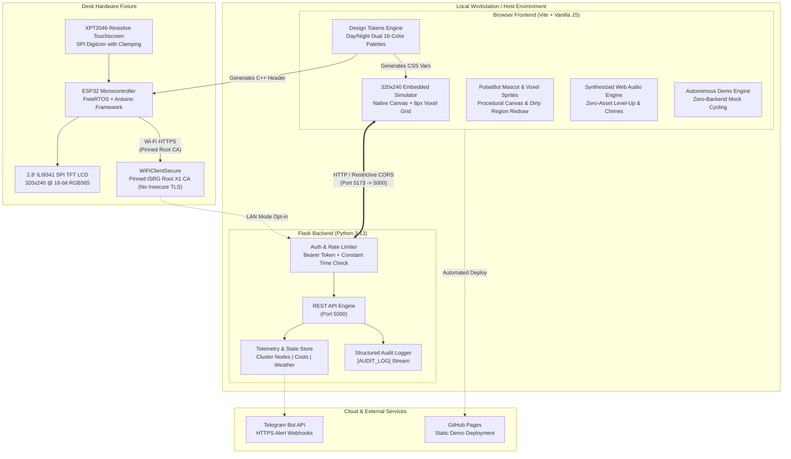

---

## 🎨 Design Decisions & Rules (Summary of `docs/DESIGN.md`)

The design system for PulseBox was created from first principles to solve a specific physical challenge: **ambient desk legibility on small displays without cognitive fatigue**.

### 1. The 1-Second Glance Rule
Desk gadgets fail when they demand active reading. PulseBox enforces that every screen has **one clear hero visualization** conveying status in under 1 second from 3 feet away:
- **Calm/Nominal:** Lush green meadow palette, smiling mascot, full heart bar.
- **Degraded/Warning:** Amber plasma glow, neutral mascot, draining hunger/XP bar.
- **Incident/Outage:** High-contrast redstone crimson, worried mascot, broken shield.

### 2. Radical Brevity (Word & Element Limits)
- **Max 3 text elements** per screen (excluding the persistent hotbar).
- **Max 12 words** total across the screen.
- Labels are strictly 1 to 3 words (e.g. `CLUSTER NODES`, `6/6 ONLINE`, `ALL NOMINAL`).
- Zero multi-paragraph text or tables on the embedded canvas.

### 3. Dual 16-Color Indexed Palettes
Rather than unbounded 24-bit color, the UI uses strictly curated 16-color indexed palettes:
- **Day Palette:** Inspired by sandbox earth, loam, cobblestone, and sunlight.
- **Night Palette:** Low-glare obsidian dark tones and vivid neon mint/cyan accents designed to prevent night-time glare.
- **Single Source of Truth:** `frontend/src/tokens.js` exports both CSS variables and 16-bit binary **RGB565** integers (`0x0000`–`0xFFFF`) for the microcontrollers.

### 4. 8px Modular Snap Grid & Touch Ergonomics
- Resolution: **320 × 240 pixels** ($40 \times 30$ grid units).
- Canvas is partitioned into a **16px status bar**, a **192px hero stage**, and a **32px hotbar** (8 slots, each exactly $40 \times 32\text{px}$).
- All interactive touch targets are $\ge 32 \times 32\text{px}$ to guarantee effortless actuation on resistive digitizers.

### 5. Progressive Disclosure ("Behind-the-Tap")
High-level state is glanceable upfront. Tapping the screen or a component opens a dedicated **Detail View** with granular metrics, log streams, and controls, always paired with a standard $32 \times 32\text{px}$ `[< BACK]` button.

---

## 🔒 Security & Threat Model

PulseBox implements defense-in-depth security across web, API, and firmware layers as defined in [SECURITY.md](SECURITY.md):

1. **Loopback-Only by Default:** The backend binds strictly to `127.0.0.1`. Binding to `0.0.0.0` is prohibited unless `PULSEBOX_ALLOW_LAN=true` is explicitly provided.
2. **State-Mutation Authentication:** All state-changing endpoints (`/simulate-failure`, `/restore`, `/reset`, `/costs/settings`, `/record-health-check`) require `Authorization: Bearer <TOKEN>` verified via constant-time hashing (`secrets.compare_digest`).
3. **Restricted CORS & Rate Limiting:** CORS origin is whitelisted to the frontend; wildcard origins (`*`) are disallowed. A sliding-window rate limiter throttles clients to 120 req/min (30 req/min for mutations).
4. **Firmware TLS Integrity:** ESP32 firmware enforces a pinned Root CA (ISRG Root X1) in `firmware/src/ca_cert.h`. Calling `WiFiClientSecure::setInsecure()` is strictly forbidden.
5. **Hold-to-Confirm & Audit Logging:** High-impact actions (power standby, factory reset) require a 1.0s to 1.5s press-and-hold gesture. All actions generate structured `[AUDIT_LOG]` records.
6. **Automated Supply Chain Scans:** CI automatically runs `gitleaks` for token leak prevention, `pip-audit` for Python dependencies, `npm audit` for frontend libraries, and weekly Dependabot updates.

---

## 🧪 Test Suites & CI Verification

The project boasts comprehensive automated test coverage spanning Python unit/integration tests, headless browser canvas tests, and hardware compilation checks:

| Test Suite | Path | Checks / Assertions | Status |
| :--- | :--- | :---: | :---: |
| **Backend REST API** | [tests/test_backend.py](tests/test_backend.py) | **72** passed |  |
| **Embedded Simulator** | [tests/test_embedded_simulator.js](tests/test_embedded_simulator.js) | **112** passed |  |
| **Design Tokens & Palettes** | [tests/test_design_tokens.js](tests/test_design_tokens.js) | **298** passed |  |
| **Voxel Component Library** | [tests/test_voxel_components.js](tests/test_voxel_components.js) | **79** passed |  |
| **Screen Word Count Compliance** | [tests/test_screen_word_counts.js](tests/test_screen_word_counts.js) | **8/8** screens |  |
| **Focus Timer Engine** | [tests/test_frontend_focus_timer.js](tests/test_frontend_focus_timer.js) | **61** passed |  |
| **Cloud Costs Module** | [tests/test_frontend_costs.js](tests/test_frontend_costs.js) | **32** passed |  |
| **Weather & Clock Screen** | [tests/test_frontend_weather_clock.js](tests/test_frontend_weather_clock.js) | **33** passed |  |
| **Incident Logging** | [tests/test_frontend_incidents.js](tests/test_frontend_incidents.js) | **27** passed |  |
| **ESP32 Firmware Build** | [firmware/src/main.cpp](firmware/src/main.cpp) | **PlatformIO** |  |
| **TOTAL ASSERTIONS** | — | **720+ checks** | **100% PASS** |

### Firmware Resource Footprint (ESP32)
- **RAM Usage:** 22,028 Bytes / 327,680 Bytes (**6.7%**)
- **Flash Usage:** 343,853 Bytes / 1,310,720 Bytes (**26.2%**)
- **PlatformIO Compilation Time:** 15.8 seconds (Zero warnings)

---

## 🚀 Quick Start Guide

### 1. Prerequisites
- **Python:** 3.11+
- **Node.js:** 18+
- *(Optional for hardware)*: [PlatformIO Core](https://platformio.org/)

### 2. Configure Environment
```bash
# Clone the repository
git clone https://github.com/your-username/pulsebox-cyber-desk.git
cd pulsebox-cyber-desk

# Set up local environment files
cp .env.example .env
cp firmware/src/secrets.h.example firmware/src/secrets.h
```

### 3. Run Backend API
```bash
cd backend
python -m venv venv
# Windows: venv\Scripts\activate | Unix: source venv/bin/activate
pip install -r requirements.txt
python app.py
```
*API will start on `http://127.0.0.1:5000`.*

### 4. Run Frontend Simulator
```bash
cd ../frontend
npm install
npm run dev
```
- Open `http://localhost:5173/simulator.html` to access the **320×240 Embedded Simulator**.
- Open `http://localhost:5173/gallery.html` to view the **Voxel Component Gallery**.
- Open `http://localhost:5173/palette_preview.html` to view the **Day/Night Swatch Palette**.

### 5. Run Automated Tests
```bash
# Run backend pytest suite
pytest tests/test_backend.py

# Run all frontend & simulator test suites
node tests/test_embedded_simulator.js
node tests/test_design_tokens.js
node tests/test_voxel_components.js
node tests/test_screen_word_counts.js
```

### 6. Build Firmware (ESP32)
```bash
cd ../firmware
pio run
```

---

## 🌐 Deploy Live Demo to GitHub Pages

PulseBox features an autonomous **Demo Mode** that cycles through simulated states (nominal, incident, recovery) with zero backend requirement. To deploy your own live web demo:

1. Push your repository to GitHub.
2. Navigate to **Settings > Pages** in your GitHub repository.
3. Under **Build and deployment > Source**, select **GitHub Actions**.
4. The workflow in [`.github/workflows/deploy-pages.yml`](.github/workflows/deploy-pages.yml) will build and deploy the standalone simulator automatically on every push to `main`.
5. Access your live simulator at `https://<YOUR-USERNAME>.github.io/<YOUR-REPO>/`!

---

## 📜 Open Source Attribution & Licenses

- **Code:** Licensed under the [MIT License](LICENSE).
- **Typography:**
  - `Silkscreen` & `Press Start 2P` are released under the [SIL Open Font License 1.1](http://scripts.sil.org/OFL).
- **Original IP:** All voxel sprites, procedural animations, and design tokens are 100% original creations for PulseBox Cyber Desk.

---

<div align="center">
  <sub>Crafted with passion for physical computing, embedded systems, and retro game design.</sub>
</div>
